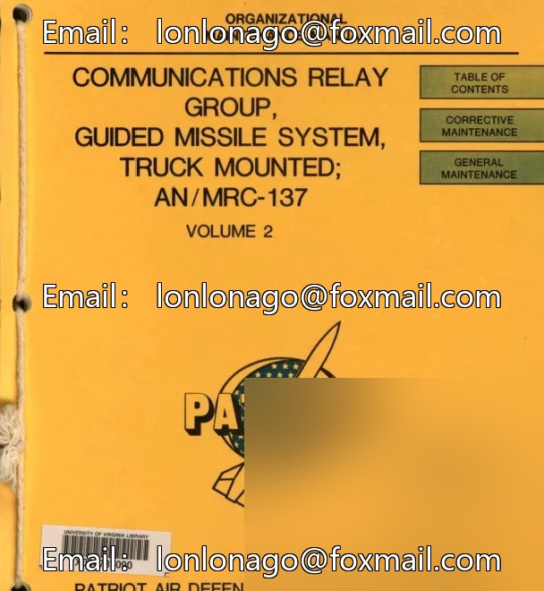
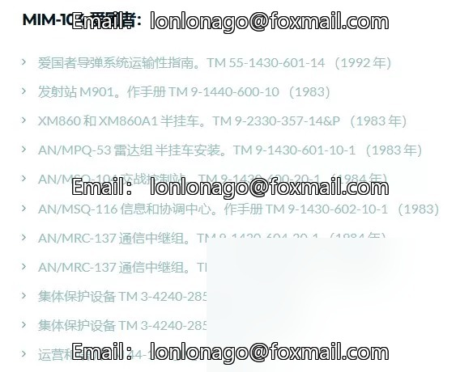
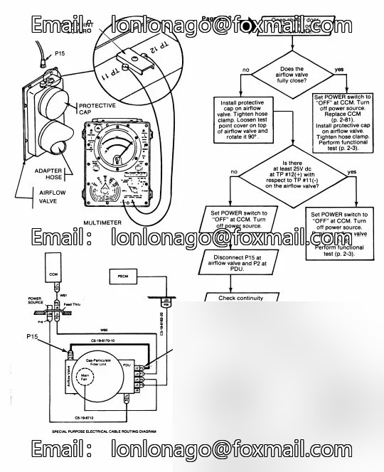
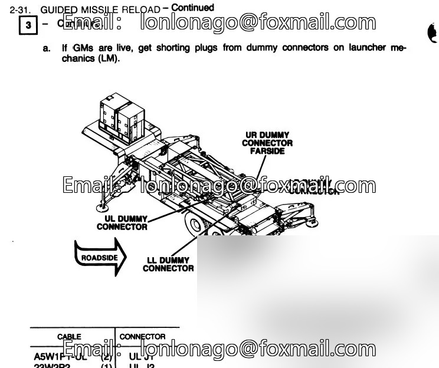
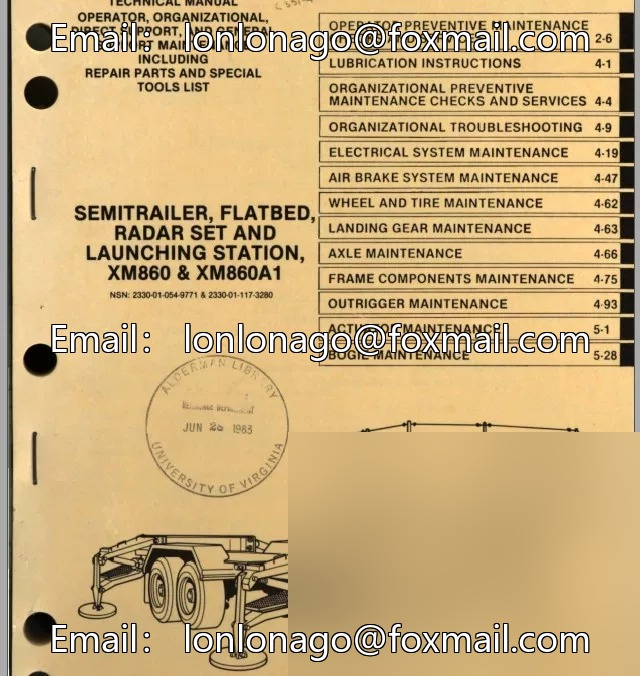

# Defense-related technical data for the Patrol Patriot Missile System, including the MIM-104 Patrol Patriot Missile System.

## Body

Related technical materials for the Patriots missile system, including the transportation guide for the MIM-104 Patriots missile system, maintenance manuals for the XM860 and XM860A1 semi-trailers, and repair manuals for the AN/MSQ-104 engagement control station, among other professional materials.

The documents are all original scans, preserved completely. Each document includes an explicit publication year, ranging from 1982 to 1987. The content covers detailed technical instructions such as system maintenance, equipment installation, and troubleshooting.
The have copyability and are returned upon sale.

Relevant technical materials for the MIM-104 missile system include transportation guides, maintenance manuals for the XM860 and XM860A1 truck-mounted, and maintenance manuals for the AN/MSQ-104 battle-control station; the materials are original scans preserved completely, each with a clearly stated publication year, covering detailed technical descriptions for maintenance, equipment installation and troubleshooting.

<!-- AI_ENRICHED -->

## Images

## Payment

Here is a pay link on Stripe ( https://buy.stripe.com/3cs8yP7sY87d0vu9AB ). Please contact me lonlonago@foxmail.com after funding $89, and I will send you a complete data files , thank you!

